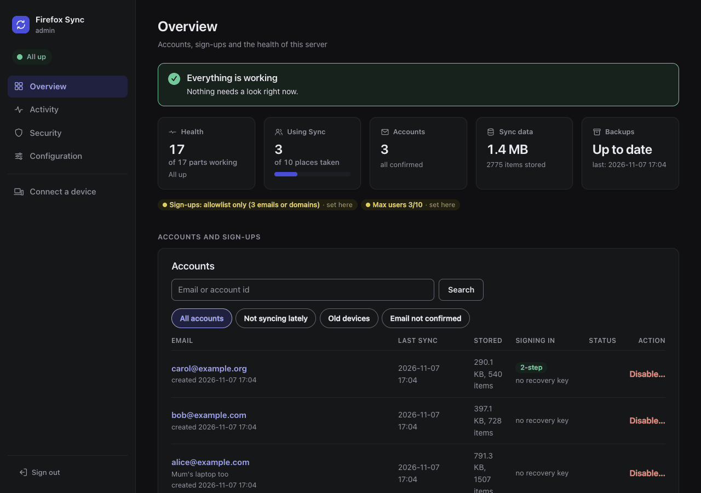

# firefox-sync documentation

Self-host Firefox Sync with Docker, Podman or Kubernetes: your bookmarks, passwords, history and tabs stay on your own server instead of Mozilla's, and optionally the Mozilla accounts too. The images are built from Mozilla's code with as few changes as possible, see [why these images](reference/images.md#why-these-images).

This is the index of every page. New here: read [What you need](#what-you-need), then follow [Choose your path](#choose-your-path).

## What you need

- **A server** that runs containers: Docker with the compose plugin, Podman, or a Kubernetes cluster.
- **A host name with HTTPS** for the Sync server, for example `sync.example.com`, behind your reverse proxy (the setup writes its configuration, or runs a bundled Caddy) or an Ingress. See [Reverse proxy](reverse-proxy.md).
- **A database.** By default the stack runs its own MariaDB containers. It can run MySQL or PostgreSQL instead, or use a server you already run: see [Databases](databases.md).
- **For self-hosted accounts only**: more host names, more memory and an SMTP server. See [their requirements](accounts.md#requirements).

Each install page lists what its platform needs on top of this.

## Choose your path

1. Install the stack, one of:
   - [Docker compose](install/compose.md)
   - [Podman](install/podman.md): Quadlets, or docker compose on the Podman socket
   - [Kubernetes with Helm](install/helm.md)
1. Point your [reverse proxy](reverse-proxy.md) to it, with the configuration the setup wrote into `proxy/`, or let the bundled Caddy do it.
1. Decide [who can use your server](access-control.md).
1. [Set up Firefox](firefox.md) on every device.
1. Turn on the [backups](backups.md).

Optional, at any time: [self-hosted accounts](accounts.md), the [admin UI](admin/README.md), [your own database server](databases.md#your-own-server).

The [admin UI](admin/README.md): accounts, storage, health, setup checks and alerts.

## Every page

Setting up:

- [install/compose.md](install/compose.md): docker compose
- [install/podman.md](install/podman.md): rootless Podman, with Quadlets or docker compose on the Podman socket
- [install/helm.md](install/helm.md): Kubernetes with the Helm chart
- [reverse-proxy.md](reverse-proxy.md): host names and ports, request size, the sign-up gate, pairing, the client IP address, publishing the admin UI
- [access-control.md](access-control.md): access control, which setting decides who can sync, reach the server and run it
- [limits.md](limits.md): who can use your server, `SYNC_MAX_USERS`, invite-only Sync (`SYNC_ALLOWED_ACCOUNTS`) and `FXA_MAX_ACCOUNTS`
- [single-sign-on.md](single-sign-on.md): single sign-on (Authelia) and client certificates in front of the accounts pages and the admin UI, and why not the other hosts
- [firefox.md](firefox.md): Firefox on desktop, Android and iOS, with Mozilla's accounts or yours
- [accounts.md](accounts.md): self-hosted Mozilla accounts, and their [telemetry](accounts.md#telemetry), all off
- [databases.md](databases.md): choosing a backend, the supported versions, your own database server

Running it:

- [backups.md](backups.md): what to keep, the backup service, copying off, restoring
- [upgrading.md](upgrading.md): new images, the earlier firefox-sync release (and Watchtower on its images), renamed settings, database majors. What changed in each release: [CHANGELOG.md](/CHANGELOG.md)
- [migrating.md](migrating.md): from another Sync server, or from docker compose to Kubernetes
- [troubleshooting.md](troubleshooting.md): symptoms and fixes, by area

The admin UI:

- [admin/README.md](admin/README.md): what it does, setting it up, reaching it
- [admin/signing-in.md](admin/signing-in.md): password, OpenID Connect, a trusted header
- [admin/accounts.md](admin/accounts.md): finding, inviting, disabling and deleting accounts
- [admin/monitoring.md](admin/monitoring.md): health, checks, metrics, the event log, Prometheus
- [admin/alerts.md](admin/alerts.md): email and the other destinations
- [admin/storage.md](admin/storage.md): the storage report, purging, maintenance

Reference:

- [reference/settings.md](reference/settings.md): every setting, its Helm value and its default
- [reference/images.md](reference/images.md): the images, their tags and the upstream patches
- [reference/database-users.md](reference/database-users.md): the database users and their grants

For contributors:

- [development/testing.md](development/testing.md): the tests and how to run them
- [development/upstream-patches.md](development/upstream-patches.md): applying upstream pull requests before their release
- [development/releasing.md](development/releasing.md): the releases and CHANGELOG.md, publishing the images and the chart
- [development/dependencies.md](development/dependencies.md): Dependabot's updates, which are merged without a human, main's CI after them

## Getting help

Search or open an [issue](https://github.com/porelli/firefox-sync/issues). Give your install method, your database backend, the versions you run and the logs, with the secrets removed.
