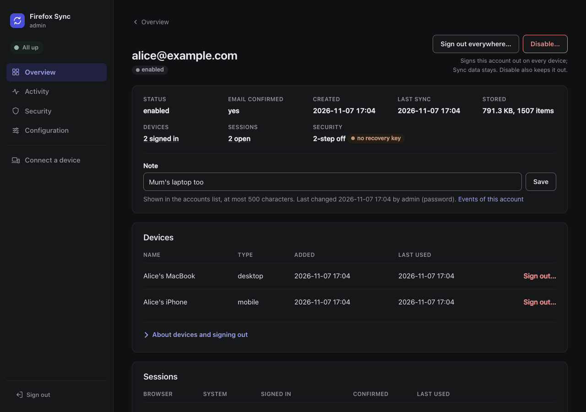
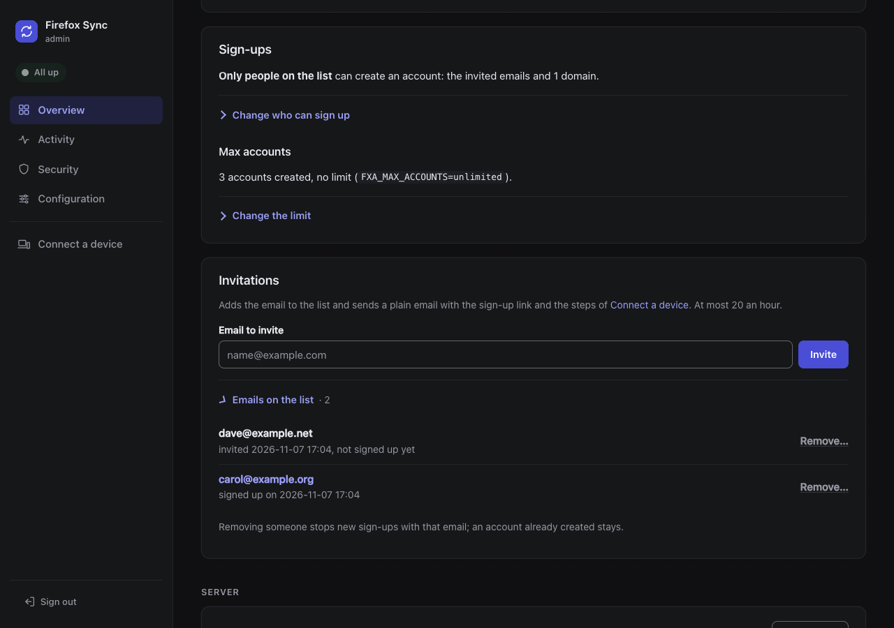

# Accounts in the admin UI

What the [admin UI](README.md) shows and does for the accounts of your server: finding them, the limits, sign-ups and invitations, signing out and disabling, helping their owners, their security history, their Sync data, deleting them, and notes. Most of it needs [self-hosted accounts](../accounts.md); with Mozilla's accounts the server knows only account ids, and the Sync data, deletion and notes parts apply.



The account page: its status, devices and sessions, how it signs in, and its note. Further down are its Sync data per collection, its emails and its security history.

## Find an account

The overview lists the accounts, 50 a page, newest first: who signed up, when they last synced, how much they store and how they sign in, with their note.

The search above the list (a plain form, `/?q=`) finds what contains it, without case:

- part of an email, of an account id, or of a note (with Mozilla's accounts, the label of an account id);
- with a whole number, the account of that tokenserver uid: any of its rows, replaced ones too (a uid as in the storage database or the Sync server's logs);
- with self-hosted accounts, a whole email finds the account of any of its addresses.

The links to the newer and older pages keep the search (`/?q=alice&page=2`). `/find?q=` goes straight to the account page of an exact email, account id or tokenserver uid.

The list marks accounts that need a look. They are only marked, never deleted by themselves:

| Mark | Meaning |
|---|---|
| inactive | not synced for `ADMIN_STALE_DAYS` (90) |
| unconfirmed | email never confirmed after 3 days. Old ones can be deleted, see [Maintenance and retention](storage.md#maintenance-and-retention) |
| `2-step` | two-step authentication on |
| `no recovery key` | no account recovery key |
| `unconfirmed sign-in` | a sign-in that never entered its email code, see [Devices and sessions](#devices-and-sessions) |
| `blocked` | blocked by the rate limits, see [Helping account owners](#helping-account-owners) |
| `inactive device` | a device not used for `ADMIN_STALE_DAYS`, marked `inactive` on the account page |

All but the first need self-hosted accounts. [Needs attention](monitoring.md#needs-attention) links to the parts of the list.

## Limits

The overview shows the accounts against their limits: in the Using Sync and Accounts tiles, the Sync card, under Sign-ups, and as the `Max users` and `Max accounts` rows of the health table.

- **Max users** of Sync: the form takes a number, or "No limit", which wins over the number. It changes the limit only with `SYNC_MAX_USERS=initial:N`; otherwise it is read-only.
- **Max accounts**, with self-hosted accounts: the same form, under Sign-ups, open when the limit is near or reached. It changes the limit only with `FXA_MAX_ACCOUNTS=initial:N`.

A change applies at once, without a restart. What each form of the two settings means, and what counts, is in [Limits](../limits.md): [`SYNC_MAX_USERS`](../limits.md#sync_max_users) and [`FXA_MAX_ACCOUNTS`](../limits.md#fxa_max_accounts).

The rows turn amber when the limit is near or reached: when that is, and how it alerts, is in [Near and full](../limits.md#near-and-full). Below that, a row shows the count and is not counted by the health light.

## Invite-only Sync

With [`SYNC_ALLOWED_ACCOUNTS`](../limits.md#sync_allowed_accounts) on, the overview has an Invite-only Sync card, under the accounts:

- **Pending accounts**: the uids the allowlist refused, with their first and last try and how many. Approve opens the confirm page that allows the uid: its next try gets in. Reject takes it off this list (`Rejected`, in a fold below, where it can still be allowed); its next tries are counted, without an alert.
- **Allow a uid**: the uid an owner sent you, with an optional note, through the same confirm page.
- **Allowed accounts**: each uid with when, by whom and its note; a link to its page once it syncs. Remove stops it from starting to sync; an account that syncs already keeps working.

Each change is in the event log with who made it and the reason typed on the confirm page: `Approved Sync account <uid>`, `Allowed`, `Rejected`, `Removed ... from the allowlist`. They need `SYNC_ALLOWED_ACCOUNTS=admin` or `initial:...`; with a plain list the card is read-only but for Reject. The admin UI's user changes the lists only through the init container's procedures, see [Database users](../reference/database-users.md).

## Sign-ups

With self-hosted accounts, Sign-ups on the overview sets who can create an account: anybody, an allowlist of emails and domains, or nobody. What each policy does, how the database enforces it, and how `.env` and the page share it, is in [Who can sign up](../accounts.md#who-can-sign-up).



Under the policy, the page lists the emails of the allowlist, and the domains apart:

- each with when it was added, and whether it signed up yet (`signed up on <date>`, matched without case, as the policy does);
- each with a Remove link to a confirm page (`/accounts/allowlist/remove?entry=...`, whose form posts to `/accounts/allowlist/remove`).

An email matches the allowlist byte for byte, after spaces are trimmed and letters lower-cased. `Alice@Example.com` matches `alice@example.com`. `alice@exämple.com`, or one with a full-width `ｅ`, matches neither it nor `@example.com`, whatever the collation of your database server. Beyond ASCII:

- An email with a character beyond ASCII needs an entry that spells it out: the exact email, or its domain (`@exämple.com`) when the part before the `@` is ASCII. An ASCII entry never matches such an email.
- An email whose lower-casing changes a character's size is refused: the Kelvin sign `K` lower-cases to the letter `k`, a look-alike of an ASCII entry.
- A Unicode domain and its `xn--` form are two different domains. The accounts keep the domain as it was typed, and the policy compares that, so list the form people sign up with. This page and `FXA_SIGNUP_ALLOWLIST` take the `xn--` form only; `ffs_access` can write either ([Access managed elsewhere](#self-hosted-accounts)).

Removing an entry stops new sign-ups with it: an account already created stays. To keep someone out who already has an account, [disable it](#sign-out-and-disable).

Saving the policy removes only the entries the page showed. An invitation sent from another tab, or by another admin after you loaded the page, stays on the allowlist.

## Invitations

**Invite**, under Sign-ups, takes an email. What it does depends on the policy:

| Policy | The email address |
|---|---|
| `allowlist` | added to the allowlist, shown as `invited <date>, not signed up yet` until they do |
| `open` | the allowlist is left alone |
| `closed` | the allowlist is left alone. The page warns that they cannot sign up until you open sign-ups, and the email says so |

It then sends them a plain text email through the stack's SMTP server (`FXA_SMTP_*`, sender `FXA_SMTP_SENDER`):

- the link to create their account, `FXA_CONTENT_URL/?email=<their email>`, which opens the sign-up page with that email;
- the steps to point Firefox on a computer, Android and iOS to this server, and to pair a phone from a computer. For a computer, the email also has the one line of a [user.js file](../firefox.md#a-userjs-file-instead-of-aboutconfig), as text to save in a file named `user.js`: an email attaches nothing, and the invitee cannot open the admin UI's download.

No HTML, no images, no tracking: the links are the plain URLs of your server. Without an SMTP server the entry is still added, and the page says the email was not sent.

At most 20 invitations an hour go out, whoever sends them, so a stolen session cannot make your SMTP server a spammer. Each one is in the event log.

**Connect a device**, in the menu, shows the same steps on a page, with this server's values, a **Download user.js** button for computers, and QR codes of the addresses a phone needs. See [From the admin UI](../firefox.md#from-the-admin-ui).

## Sign out and disable

Three actions, from the strongest:

| Action | Where | What it does |
|---|---|---|
| **Disable** | the accounts list or the account page, then the confirm page | signs the account out of every device, refuses new sign-ins, and revokes its OAuth tokens, in the accounts database and in Redis. **Enable** gives the account back, with its data, after a new sign-in. With [access managed elsewhere](#enable-and-delete), Enable refuses an account whose email the sign-up policy refuses |
| **Sign out everywhere** | the account page | the same for the devices, sessions and tokens, but the account stays active: its owner can sign in again right away. Use it after a lost laptop, or a leaked password (with a new password) |
| **Sign out** a device or a session | next to it, on the account page | removes that device and the session or refresh token it signed in with, so it cannot get new access tokens |

**Firefox keeps syncing for up to about an hour after any of them.** The Sync server remembers a verified access token for 5 minutes, and a Sync token it handed out stays valid for up to 1 hour. After signing out a single device, the access tokens it already has also keep working until they expire (`FXA_ACCESS_TOKEN_LIFETIME`, `60 minutes`). To lock every device out at once, sign out everywhere.

`FXA_ACCESS_TOKEN_LIFETIME` takes any duration (`2 hours`). Revoking makes it irrelevant for disabled accounts. A short one is a backstop in case revoking fails (the page tells you), at the cost of Firefox asking for a new token every hour, which a small server does not notice. Mozilla's default is `365 minutes`.

Keep the lifetime as it is if you turn on JWT access tokens (`JWT_ACCESS_TOKENS_ENABLED_CLIENT_IDS`, off by default). Those living 6 hours or less are checked by their signature only, and cannot be revoked.

Signing out goes through Mozilla's own procedure, `revokeAccountTokens_1`: sessions, key fetch, account reset, password change and password reset tokens, unconfirmed sign-ins, unblock codes and devices, then the OAuth tokens and codes. Mozilla's own admin panel, not part of this stack, disables accounts the same way, without revoking the tokens.

**If an action answers with an error**, a Mozilla procedure it needs may be missing. `fxa-policy` checks at every start that they exist, and logs a warning with the name of a missing one. The accounts keep working, but what needs it fails. Update the admin UI image, or, on your own database server, grant `EXECUTE` on `fxa.*` to the policy user. How the admin UI reaches the accounts database is in [The accounts](../reference/database-users.md#the-accounts).

### Devices and sessions

The devices and sessions on the account page say whether they are confirmed, and when they were really last used:

- The accounts service writes most uses to its Redis only. The admin UI reads them there once per account page, and shows the later of the two.
- The stack has it record every use (`LASTACCESSTIME_UPDATES_SAMPLE_RATE=1`). Mozilla samples 30% of the accounts.
- That cache holds the session token ids: the admin UI turns each into its hash right away and keeps nothing else.

A session that never entered the code sent by email, or the second step, is marked `unconfirmed sign-in`, in the list too. It cannot sync. A sign-in you do not expect there means someone has the password: **Sign out…** it, and have the owner change the password.

**Confirm this sign-in…** next to it is for a sign-in you know is theirs, when the code sent to the address never arrives (a new device asks for one, after the first 48 hours of the account). Whoever has the password gets in with it: its confirm page says so. It does what entering the code does in the accounts database, with Mozilla's own procedures: `verifyTokensWithMethod_3` sets the session's method (`email-2fa`, as the code) and time, then `verifyToken_3` marks the security events of that sign-in confirmed and removes its unconfirmed tokens, the session's and its key fetch token's. Nothing else changes: the admin UI never reads the code, nor the token ids.

It is not offered for:

- an account whose email is not confirmed: **Confirm the email…** confirms its sign-ins too, see [Their confirmation email never arrived](#their-confirmation-email-never-arrived);
- an account with two-step authentication on: its sign-in waits for the authenticator's code, never an email code. If they lost it, see [They lost their authenticator app](#they-lost-their-authenticator-app).

The browser waiting at the code prompt does not notice. In Mozilla's code (fxa-mono v1.348.x) the code pages never check the session again, and Firefox gets the Sync keys from the page only after the code. The person signs in again there:

- within 48 hours of the sign-up, that sign-in asks for no code (Mozilla's rule for new accounts);
- later, it asks for a code of its own again. The session you confirmed is then of use to a browser that kept it, such as the account settings once reloaded, not to the Firefox that waited.

The owner gets an email saying that an administrator confirmed a sign-in, with its device, time and IP address, and a link to the account settings to sign it out. The event log has `Confirmed a sign-in of <email> (<device>, <time>)`, with your reason.

## Helping account owners

The account page of a self-hosted account shows how it signs in, without any secret. The admin UI never reads the authenticator's key, the backup codes, the recovery key's data or the phone number.

- two-step authentication (an authenticator app), with the backup authentication codes left, and whether a recovery phone is set;
- whether it has an account recovery key, and its passkeys;
- when the password was last set, and the keys last changed;
- all its emails, primary and secondary, and whether they are confirmed. A secondary email is in the accounts database once confirmed.

### They forgot their password

They use Forgot password at `FXA_CONTENT_URL/reset_password` themselves. With a recovery key nothing is lost.

Without one, the reset gives the account new keys, and the Sync data on the server can no longer be read. They first open Firefox on a device that still has the data, so it uploads it again after the reset. The account page says so.

### They lost their authenticator app

And their backup codes too:

1. **Make sure who is asking.** From then on, the password and the mailbox are enough to get in.
1. Click **Turn off…** next to two-step authentication on the account page.
1. On the confirm page, keep "sign out everywhere" on (the default), so that if someone else got in, they are out too.

It removes the authenticator, the backup codes and the recovery phone in one transaction (Mozilla's `deleteTotpToken_4`). They then sign in with the password and a code sent by email.

### A recovery key leaked

Click **Remove…** next to it (Mozilla's `deleteRecoveryKey_2`). The confirm page has the same choice to sign out everywhere.

After either of these, or after confirming an email or a sign-in, the owner gets a plain email from the stack's SMTP server (`FXA_SMTP_SENDER`), such as "An administrator turned off two-step authentication on your account", with a link to the account settings to set it up again. The admins get the alert of the change. Without `FXA_SMTP_HOST` nothing is sent, and the page says so.

### Their confirmation email never arrived

Click **Confirm the email…** on the account page of an unconfirmed account. It skips the proof that whoever signed up owns the address: do it only when you know who they are.

The confirm page lists the sign-ins waiting for their code at that moment, usually the one of the sign-up: their device, browser, system, IP address (with the [security history](#security-history) on) and time. They are confirmed too, as [Confirm this sign-in…](#devices-and-sessions) does, and only those: a sign-in made after the page opened is not. (The form posts their refs in its `sessions` field; a script posting to `/accounts/<uid>/confirm-email` without it confirms the email only.)

Then the person signs in again in their Firefox: the page still waiting for the code does not move on by itself. Within 48 hours of the sign-up no code is asked; after that, a new sign-in asks for one.

The owner gets an email saying that an administrator confirmed it, with the sign-ins confirmed. The event log has `Confirmed the email of <email> and its <n> pending sign-ins`, with your reason. A sign-in confirmed in between by its code is said on the page; the email is confirmed anyway.

### They are blocked

After too many wrong passwords or codes, the accounts service blocks them. The list marks them `blocked`, and the account page says until when, with a **Lift** button. The Security page, in the menu, lists every block and who is getting close, with the same button.

Every round of checks (every minute) the admin UI reads the blocks:

- A new block of an existing account is recorded and alerted once per account and action: on its email (alone or with an IP address) or its uid.
- Blocks of emails that have no account, and of IP addresses alone, are left to the Security page: anybody can cause those.
- Thousands of those do not hide the block of an account. The admin UI reads the names of all blocks (up to 100,000; past that every page says so), and the details only of those of accounts.
- The Security page lists the blocks of accounts first, then at most 1,000 others, and says how many it leaves out.

Each of these changes is in the event log, with who made it, the account's email and the reason given. The profile server's cache of the account is dropped afterwards, so the account settings show the change at once.

## Security history

With self-hosted accounts and `FXA_ACCOUNT_EVENTS=true`, the account page lists its security history: the newest 50 entries, as its owner sees them in Recent activity of the account settings. The setting is off by default, because it keeps the IP address of every sign-in: see [Security history](../accounts.md#security-history) for what it changes and keeps.

Each entry shows:

- the event: signed in, wrong password, password changed or reset, two-step authentication on or off, recovery key created or removed, backup codes, emails, passkeys, signed out, and Mozilla's name for the others;
- when, and the IP address;
- whether the sign-in of the event was confirmed. `not confirmed` means its code or second step was never entered, which for a sign-in you do not expect means someone has the password.

With the setting off, the page says how to turn it on, and still lists what was recorded before.

### Alerts

These events, made by the owner in the account settings (or whoever has their session), are events of kind `security` in the event log and the [alerts](alerts.md):

```text
alice@example.com (uid 3f2a1b2c): password changed, from 203.0.113.5
```

They have the caps of every kind: 30 a minute in the log, 20 a message. The alerts then carry IP addresses too.

| Alert | Mozilla's event |
|---|---|
| password changed | `account.password_changed` |
| password reset (forgotten password) | `account.reset` |
| password set (an account without one) | `account.password_added` |
| primary email changed | `account.primary_secondary_swapped` |
| two-step authentication turned on, turned off, authenticator app replaced | `account.two_factor_added`, `account.two_factor_removed`, `account.two_factor_replace_success` |
| backup codes created, replaced | `account.recovery_codes_created`, `account.recovery_codes_replaced` |
| recovery key created, removed | `account.recovery_key_added`, `account.recovery_key_removed` |
| passkey added, removed | `account.passkey.registration_success`, `account.passkey.removed` |
| recovery phone added, replaced, removed | `account.recovery_phone_setup_complete`, `account.recovery_phone_replace_complete`, `account.recovery_phone_removed` (no SMS here, unless you add it) |

Not alerted:

- `account.password_reset_success` ("new password saved"), which Mozilla records next to `account.password_changed` on every password change;
- the backup codes saved while turning on two-step authentication (`account.recovery_codes_set`), which come with its alert.

What the admin UI itself turns off or removes is in the audit trail already (kind `admin`): Mozilla's procedures it calls record no security event. Prometheus counts every event by its name, see [Prometheus](monitoring.md#prometheus).

After a restart, an upgrade or a host that was off, the admin UI reads on from where it stopped, at most `ADMIN_RETENTION_DAYS` back. So a password changed, two-step authentication turned off, or a recovery key added in the meantime is alerted once, late, and not twice. Without `ADMIN_DB_PASSWORD`, and at the first start of a release with it, events from before the start of the admin UI are not alerted.

<details><summary>How it reads the history, and what it costs</summary>

Every round of checks the admin UI reads the new events of every account, oldest first, by pages of 10,000 and up to 100,000 a round. A burst (thousands of wrong passwords, a catch-up after the accounts database was down) only delays the next ones to the following rounds: none is skipped. Where the reading is, and the alerted events it may read again, are kept in the admin UI's database (`ffs_meta`) after every page.

Mozilla's table has no index on the time of the events, so each round scans all of `fxa.securityEvents` (on your server with `EXTERNAL_DB`), as the daily pruning does. Kept for 30 days on a server of a few people, that is a few thousand rows: nothing. With thousands of accounts or a long `ADMIN_RETENTION_DAYS`, keep an eye on it. The stack does not change Mozilla's tables.

The admin UI reads the history through the view `ffs.security_events`. What it reads of each entry, and how long the entries are kept: [Security history](../accounts.md#security-history).
</details>

## Sync data

The account page lists every row the tokenserver has for the account. syncstorage-rs adds one, with a new uid and new, empty storage, each time the account's keys change: a password reset without the recovery key, for example. The current one, where Firefox syncs, is marked.

For each row it shows:

- its uid (the user id in the storage) and its client state (a hash of the keys);
- keys changed at, as Firefox sends it;
- its node, when it was created and replaced;
- what its storage holds, per collection (bookmarks, history, passwords...): items, size, last change. The data itself is encrypted by Firefox: the server cannot read it.

With self-hosted accounts the page also shows when the accounts service last changed the keys and set the password. The generation is not shown: with OAuth sign-ins it is always 0.

What looks wrong is said in one line each:

| Flag | What it means |
|---|---|
| Several current rows | more than one row is not replaced: the tokenserver uses the newest, and what the others store is never read |
| Keys went back in time | a row has an older `keys_changed_at` than the one before it: a device with old keys, or the accounts database restored from a backup |
| Keys changed without a date | new keys (client state) with the same `keys_changed_at`: the accounts service did not record the change, and devices may disagree on the keys |
| Unknown node | the current row points to a node the tokenserver does not have: Sync tokens fail |
| Node retired | the current row is on a downed node: the next sign-in moves the account to empty storage |
| Data left on old keys | the current storage is empty while a replaced row still holds data: encrypted with the old keys, Firefox cannot read it. A device that still has the data uploads it again |

### Reset the Sync data

**Reset the Sync data**, on the account page and then the confirm page, deletes what the storage holds for the current row. It keeps the account and its tokenserver row. Each Firefox finds the server empty on its next sync, and uploads what it has again. Data that is only on the server is lost.

**Reset…** next to a collection deletes that collection only. Firefox does not notice it by itself: it sends again what changes on a device, or everything after Sync is reset there (disconnect, then sign in again).

The checkbox **also free the max users slot** deletes the account's tokenserver rows too, with the storage of each. The account no longer counts towards max users, and its next Sync token goes through the limit again: refused when the server is full.

Every reset is in the event log and the alerts. It deletes 1000 items at a time, so the Sync server keeps answering: on MariaDB from `bso`, `user_collections`, `batch_uploads` and `batch_upload_items`; on PostgreSQL from `bsos`, then `user_collections`, which takes the batches with it.

## Delete an account

Deleting is for a disabled account only:

1. [Disable](#sign-out-and-disable) the account.
1. Click **Delete the account for good…** on its page.
1. Type its email on the confirm page.

`ffs.delete_account` refuses an account that is not disabled, whatever sends the request.

What goes:

- **In the accounts databases**, in one transaction: its recovery phone; its OAuth codes, refresh and access tokens, activity and consents (`fxa_oauth`); its profile and avatars (`fxa_profile`); its push messages (`pushbox`). Then Mozilla's own deletion (`deleteAccount_24`, reason `fxa_admin_requested_account_delete`): sessions, keys, devices, emails, two-step authentication, recovery key and codes, security events.
- **On the allowlist**: its exact email, so that with sign-ups on an allowlist it cannot sign up again unless invited. Not with [access managed elsewhere](#enable-and-delete): the list is the other system's.
- **In Redis**: its access tokens, the cache of its sessions and refresh tokens, its profile.
- **On the Sync side**: every tokenserver row of `<uid>@<FXA_EMAIL_DOMAIN>`, with the storage of each, which frees its max users slot.
- **Its note.**

Firefox can keep writing for up to an hour with the Sync token it has. A second pass deletes that storage again 65 minutes later. A restart of the admin UI forgets that pass; the [purge](storage.md#purge) then finds that storage, which has no tokenserver row.

If something fails once the account is gone from the accounts database (Redis, the Sync data, the note), the page says what. The event log still records the deletion, with the error. Delete the Sync data again from the account's page, which stays as long as tokenserver rows are left.

The event says who was deleted, with the email, by whom and why. An avatar image, if the owner uploaded one, stays in the `fxa-profile-images` volume: the files are named by a random id, not by the account.

With Mozilla's accounts, or for an account id whose self-hosted account is gone, the same page deletes the Sync data and the tokenserver rows of the account id: type the id to confirm. The account itself is Mozilla's: it can sync here again, as a new account.

## Notes

Each account has a note, up to 500 characters on one line: who it is, why it was disabled. Edit it on the account page.

- The accounts list shows it under the email. With Mozilla's accounts it shows next to the account id, where it is the only way to tell whose an account is.
- The reason given when disabling an account is added to its note.
- Notes are kept in the admin UI's database (`ffs_account_notes`), with who changed them last, and every change is in the event log.

Like the event log, notes are personal data. Deleting an account for good removes its note: from its page, by the purge, or with the old unconfirmed accounts.

## Access managed elsewhere

For integrators: another system, with its own sign-in and its own list of people, decides who may use the server. The admin UI then shows who may come in and changes none of it. Turn it on with `ADMIN_ACCESS_EXTERNAL=1` (Helm: `admin.accessExternal: true`). It is not asked by `prepare_environment.sh`.

The name: `ADMIN_` because it is a mode of the admin UI, as the other `ADMIN_*` settings (the init container also reads `ADMIN_DB_*`); `ACCESS` for who may use the server, the limits, the allowlists and the sign-ups, not who may use the admin UI, which is `ADMIN_AUTH_*` and `ADMIN_ALLOWED_*`; `EXTERNAL` because that is decided outside. It takes `1`, `true` or `yes`, as `ADMIN_INSECURE_COOKIE`.

### What is read-only

| Part | With the mode on |
|---|---|
| Max users, max accounts | shown, no form. No amber tile, row or alert when near or full |
| Invite-only Sync | a **Who may sync** card: the rows of `sync_allowed_accounts`, no Approve, Reject, Allow a uid or Remove. No pending list, no `sign-up refused` alert |
| Sign-ups, the sign-up allowlist | the policy and the list, without the form or Remove |
| Invitations | the list of emails, no Invite |
| The overview's badges | one notice, `Access managed elsewhere`, instead of `Sign-ups closed`, `Max users 3/5` and the like |

Every form and confirm page of those refuses the change in its handler, whatever the page shows: `POST /sync/max-users`, `/sync/allowlist/{allow,reject,remove}` (and their confirm pages), `/accounts/signups`, `/accounts/max-accounts`, `/accounts/invite` and `/accounts/allowlist/remove` (and its confirm page). The message says that access is managed outside the admin UI, and nothing changes.

The rest works as usual: health and monitoring, storage and purge, alerts, backups and the event log, the account pages, notes, signing out and disabling an account, and the reset and deletion of Sync data. Enable and Delete work too, but leave who has access to the other system.

### Enable and delete

With self-hosted accounts, two of the admin UI's account actions would otherwise change who has access:

| Action | With the mode on | Without it |
|---|---|---|
| **Enable** | refused when the sign-up policy refuses the account's email, as a new sign-up of it would be: off the allowlist with `FXA_SIGNUPS=allowlist`, everyone with `closed`. The page says `not on the access list managed elsewhere: the system that manages access enables this account`, and the account stays disabled. Max accounts does not refuse it: the account is already counted, enabling adds none | enables the account |
| **Delete** | deletes the account and leaves `ffs.signup_allowlist` as it is: a current member can sign up again, and your system removes the row if it wants to | also removes the account's exact email from the allowlist |

**Disable** stays as it is in both modes, for incident response. An account the admin UI disabled whose email is still on the list can be enabled there again. Your system's `ffs.enable_account_by_email` never asks the policy: it enables whatever your list says, even before you add the email again or with `FXA_SIGNUPS=closed`.

`fxa-policy` makes these procedures again at every start, as the mode says: the first start without it gives back the behaviour of before. `ffs_admin` gets the same procedures either way, and the database refuses the enable to a database client too.

### The database enforces it too

The admin UI's handlers refuse the changes, and its database users lack the grants for them. At every start the init container and `fxa-policy` take those grants back, and give them again once the mode is off. The admin UI's users then cannot change who may use the server, whether through the admin UI or with a database client:

| Engine | `ADMIN_DB_SYNC_USER` (`ffs_admin_sync`) with the mode on | without it |
|---|---|---|
| MariaDB, MySQL | `SELECT`; `EXECUTE` on `ffs_delete_user_row`, `ffs_drop_admin_tables` and `ffs_resync_node_load` only | also `EXECUTE` on `ffs_set_max_users`, `ffs_allow_account`, `ffs_remove_allowed_account`, `ffs_reject_account` and `ffs_mark_refusal_reported` |
| PostgreSQL | `SELECT`; `DELETE` on `users` and the storage tables; `EXECUTE` on `ffs_drop_admin_tables()` and `ffs_resync_node_load()` only | also `UPDATE (config_value)` of `config` (max users) and `EXECUTE` on `ffs_allow_account()`, `ffs_remove_allowed_account()`, `ffs_reject_account()` and `ffs_mark_refusal_reported()` |

In both modes, `ADMIN_DB_SYNC_USER` has no `INSERT`, `UPDATE` or `DELETE` on `sync_allowed_accounts` or `sync_refused_accounts`, and no `EXECUTE` on the whole tokenserver database. On PostgreSQL, `PUBLIC` has no `EXECUTE` on these functions either. Calling one of them, or an `INSERT` into the list, fails with the database's permission error. The admin UI never calls them with the mode on. Everything else keeps working: monitoring, storage and purges, **Reset the Sync data** with its slot freed, **Delete**, notes, the event log, and reading the lists.

With [self-hosted accounts](../accounts.md), `ffs_admin` gets only `SELECT` on `ffs.settings` (the sign-up policy, max accounts) and on `ffs.signup_allowlist`. Without the mode it gets `SELECT, INSERT, UPDATE, DELETE` on both. Its procedures for an account (disable, enable, sign out, delete) stay in both modes, with enable and delete leaving access alone with the mode on ([Enable and delete](#enable-and-delete)). `ffs_access` keeps exactly its own grants.

The setup check **Access managed elsewhere: database grants** reads what the admin UI's users hold. It warns when they can still change who may use the server with the mode on. It also warns, in either mode, when they lack what the admin UI calls. It is shown whenever the mode is on, and without it only when something is missing.

Where it needs more from you:

- **Your own MariaDB or MySQL server**: the init container sets these grants as the tokenserver's user, and that user needs `GRANT OPTION` on its database for it. The stack's database containers give it. On your own server the setup migrations give `ffs_admin_sync` `EXECUTE` on the whole tokenserver database, and the init container cannot narrow that by itself. Without the mode it says so in its log, and so does the setup check. With the mode on it stops (exit 1), and the Sync server with it, until the grant below is there: the mode runs only with the database enforcing it, never half. Run this once, as the server's administrator, with your names:

  ```sql
  GRANT EXECUTE ON `tokenserver`.* TO 'tokenserver'@'%' WITH GRANT OPTION;
  ```

  The next start of the init container then gives `EXECUTE` per procedure and takes back the database-wide grant. Running `database-setup.sql` again gives that grant back. The next start of the init container takes it back again. With `GRANT OPTION`, the tokenserver's user can grant what it holds on its own database to other users of the server. That is what owning the tables gives on PostgreSQL.
- **PostgreSQL**: nothing more. The init container sets the grants as the owner of the Sync tables, on the stack's container and on your own server alike.
- **An install without `ADMIN_DB_PASSWORD`**: the admin UI connects as the Sync server's own user, which the database cannot tell apart from the Sync server. Only the admin UI refuses the changes there, and the setup check says so. Give the admin UI users of its own: [The admin UI's own database](../upgrading.md#the-admin-uis-own-database).

### The objects you own

On the tokenserver database:

- **The rows of `sync_allowed_accounts`**: `uid` (the account id, 32 hexadecimal characters, lowercase), `note`, `added_at` (milliseconds since 1970) and `added_by`. The init container creates the table when it is missing and never writes a row with the mode on. You may create it first, with constraints of your own, as long as it has these columns: the admin UI reads them.
- **Your own trigger on `users`**, with your own function, under names of your own. It sees every new row of the tokenserver: refuse those of accounts not on your list, for example with `RAISE EXCEPTION` (PostgreSQL) or `SIGNAL` (MySQL and MariaDB). The tokenserver then answers 500, issues no token, and Firefox tries again later.

What stays firefox-sync's, made again or replaced at every start of the init container: the tables `config` and `sync_refused_accounts`, the triggers `before_insert_user` and `before_insert_allowed_user` (MySQL and MariaDB: `BeforeInsertUser` and `BeforeInsertAllowedUser`), the function `check_user_limit()` (procedure `CheckUserLimit`), and every function or procedure named `ffs_*`. Do not name anything of yours like these, nor change them.

With the mode on, the init container:

- refuses to start with a `SYNC_ALLOWED_ACCOUNTS`: that would be a second list;
- writes no row of `sync_allowed_accounts`, and deletes none;
- keeps its own invite-only trigger off: it drops `before_insert_allowed_user` (`BeforeInsertAllowedUser`) if a start without the mode had made it, and never makes it;
- writes `allowed_accounts = external` in `config`. The admin UI's setup check **Access managed elsewhere** warns when only one of the two has the mode.
- takes back the admin UI's grants on max users and the allowlist: [The database enforces it too](#the-database-enforces-it-too).

Max users still applies, as `SYNC_MAX_USERS` says: set `SYNC_MAX_USERS=unlimited` if your system is the only limit. The init container still keeps one node and counts its load again at every start, as without the mode.

### Reset and delete

Both stay, and neither touches your list:

- **Reset the Sync data** deletes the storage of the account's current row. With **also free the max users slot** it also deletes its rows of `users`.
- **Delete** (with Mozilla's accounts, of an account id) deletes the rows of `users` and the storage of each.

The next sign-in of an account without rows is a new `INSERT` into `users`, which your trigger checks. So to stop an account that syncs: take it off your list, then delete its Sync data, or reset it with the slot freed. Taking it off the list alone stops nothing for an account that has its rows already. Firefox's Sync token lasts up to an hour, and a second pass deletes what it wrote meanwhile ([Delete an account](#delete-an-account)).

### Self-hosted accounts

With [self-hosted accounts](../accounts.md), your system can keep the sign-up allowlist itself and act on the accounts by email, with a database user of its own, `ffs_access`. Give it a password with `FXA_ACCESS_DB_PASSWORD` (Helm: `fxa.accessDbPassword`, or the key `FXA_ACCESS_DB_PASSWORD` of an `existingSecret`). `fxa-policy` then creates it on the stack's accounts database, at every start, with only these grants:

| Object | `ffs_access` |
|---|---|
| `ffs.signup_allowlist` (`entry`: an email or `@domain`, lowercase) | `SELECT, INSERT, DELETE` |
| `ffs.disable_account_by_email(email)` | `EXECUTE`: disables the account and signs it out everywhere, as Disable in the admin UI |
| `ffs.enable_account_by_email(email)` | `EXECUTE`: enables the account, whatever the sign-up policy says |
| `ffs.delete_account_by_email(email)` | `EXECUTE`: deletes a disabled account, as Delete in the admin UI. With the mode on, its row of `ffs.signup_allowlist` stays: remove it yourself |
| `ffs.disable_accounts_not_allowed(p_max)` | `EXECUTE`, with the mode on only: disables every enabled account your list no longer allows, at most `p_max` ([The sweep](#the-sweep)) |

Nothing on `fxa.*` and nothing on `ffs.settings`: the procedures run as their definer. The email of the procedures by email is the one the account signed up with, compared without case and spaces: when someone changes their primary email in the account settings, the accounts keep the first one there. An unknown email answers `no such account`.

- Without `FXA_ACCESS_DB_PASSWORD`, `fxa-policy` drops the user. Give the password at every start: in `.env`, which `--upgrade` keeps, or in your values or `existingSecret` with Helm.
- `fxa-policy` makes the procedures again at every start, which drops their grants, and then gives them again. The rows of `ffs.signup_allowlist` stay: its table is never made again.
- A backup holds the `ffs` database, with the rows and the procedures, not the users. After a restore, the next start of `fxa-policy` creates `ffs_access` again.
- On your own accounts server the policy user cannot create users: create `ffs_access` yourself (`CREATE USER 'ffs_access'@'%' IDENTIFIED BY '...'`), and `fxa-policy` gives it the grants.

With the mode on, `fxa-policy` sets `FXA_SIGNUPS` at every start (`allowlist`, for this) and leaves the rows of the sign-up allowlist alone. It refuses a `FXA_SIGNUP_ALLOWLIST`, which would be a second list. It gives the admin UI's `ffs_admin` only `SELECT` on `ffs.settings` and `ffs.signup_allowlist` ([The database enforces it too](#the-database-enforces-it-too)).

An account whose email leaves the list stays, and keeps working: the list decides who may create an account, not who has one. Disable it with `ffs.disable_account_by_email`, or let [the sweep](#the-sweep) find it. The access tokens Firefox already holds stay valid until they expire (`FXA_ACCESS_TOKEN_LIFETIME`): the database cannot reach their copies in Redis, which Disable in the admin UI also removes. `ffs.delete_account_by_email` deletes the account, not its Sync data: delete that on its page in the admin UI, which stays as long as tokenserver rows are left.

With this, `SYNC_ALLOWED_ACCOUNTS` can stay off: every account of the server is one your system let sign up.

#### The sweep

Someone can change their account's primary email after signing up, to one your list never had. Your system then knows no email that finds the account. `ffs.disable_accounts_not_allowed(p_max)` finds them all: it disables, and signs out everywhere as `ffs.disable_account_by_email` does, every enabled account whose current primary email the sign-up policy refuses. It asks `ffs.signup_refusal`, so the emails and `@domain` rows of `ffs.signup_allowlist` count as for a sign-up, compared the same way. Max accounts does not count here. Accounts already disabled stay as they are and are not counted.

Call it at the end of every reconcile, after the `COMMIT` of your allowlist changes, with `p_max` the number of people you expect to leave plus a small margin:

```sql
CALL ffs.disable_accounts_not_allowed(5);
```

- **The count**: the call returns one row with one column, `disabled`, the number of accounts it disabled. Read it like the result of a `SELECT`.
- **The brake**: it counts first and changes nothing yet. If more than `p_max` accounts would be disabled, it disables none and fails with SQLSTATE `45001`, error 1644, and the message `disable_accounts_not_allowed: 7 accounts would be disabled, more than p_max 5`. `p_max` equal to the count passes. So a list emptied by mistake, or `FXA_SIGNUPS=closed`, cannot disable everyone, while a group you emptied on purpose passes with the right `p_max`. A `NULL` or negative `p_max` fails with SQLSTATE `45000` and `disable_accounts_not_allowed: p_max must be a number, 0 or more`. Some drivers give only the error number and the message, Python's for one: match the message's start, `disable_accounts_not_allowed: `, and the words `would be disabled` then.
- **Your list decides**, not a list passed in. You already keep the allowlist: one source, and nothing to parse in SQL. With `FXA_SIGNUPS=open` the sweep finds no one.
- **The current primary email**: someone who changes it to an email off your list is disabled by the next sweep, even if their first email is still on it. Enable them with `ffs.enable_account_by_email` and their first email, after you add the new one to your list.

It is not one transaction, and it opens none of its own:

- It runs in your session. The brake, a bad `p_max` and a sweep with no one to disable change nothing and commit nothing: a transaction of yours stays open, as it was.
- Each account it disables commits. Signing out runs `START TRANSACTION` in Mozilla's `revokeAccountTokens_1` and again for the OAuth tokens, and in MySQL and MariaDB that commits whatever transaction is open. Called inside your transaction, the first account disabled also commits your changes before it. Call it after your `COMMIT`.
- A failure halfway, such as a lock wait timeout or a lost connection: the accounts before it stay disabled and signed out, and the rest are untouched. The account it was at is disabled, and may still have sessions or OAuth tokens: sign it out with **Sign out everywhere** on its page in the admin UI. The call fails, with no count. Call it again for the rest. The disabled account is not counted again.
- Between the count and the changes, each account is checked again. One whose email went back on your list meanwhile stays enabled, and the sweep never disables more than it counted.

`fxa-policy` makes the sweep, and gives `ffs_access` its `EXECUTE`, only with `ADMIN_ACCESS_EXTERNAL` on. A start without the mode drops it, and with it the grant.

### Sign-in to the admin UI

The mode says nothing about who may use the admin UI. Behind your system's sign-in, use the [trusted header](signing-in.md#trusted-header): `ADMIN_AUTH_HEADER` (the email), `ADMIN_AUTH_GROUPS_HEADER`, `ADMIN_TRUSTED_PROXIES` (your proxy only) and `ADMIN_ALLOWED_GROUPS` or `ADMIN_ALLOWED_USERS`. Turn the password off with an empty `ADMIN_PASSWORD` (Helm: `admin.passwordSignIn: false`).
